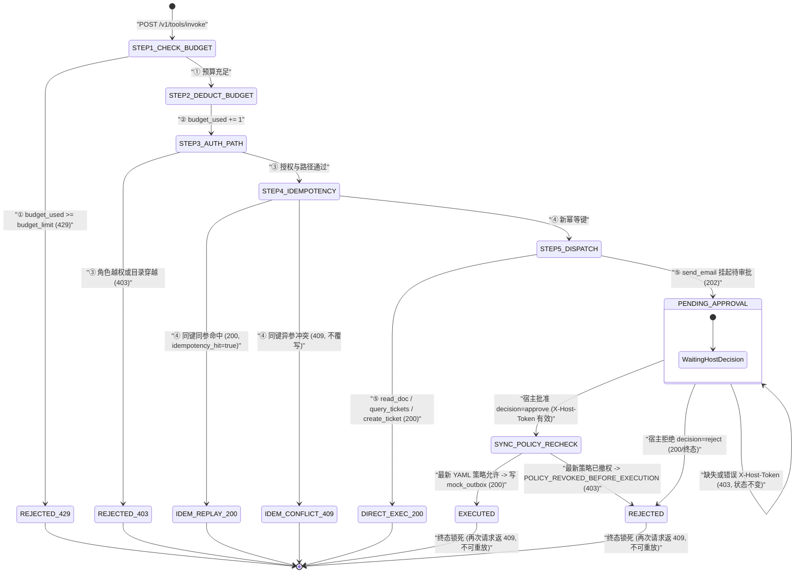

# System Architecture & ADRs: `agent-tool-gateway`

- **仓库与目录**：`agent_tool_gateway`（GitHub：`lingjj59/agent_tool_gateway`）
- **设计依据**：[TASK_CHARTER.md](../TASK_CHARTER.md)、[project-brief.md](../brief/project-brief.md)、[specification.md](./specification.md)

---

## 1. 请求前置流水线与高风险审批状态机（Pipeline & State Diagram）

### 1.1 `POST /v1/tools/invoke` 固定 5 步前置流水线顺序
所有工具调用入口必须严格按以下固定顺序执行，**严禁调换前后次序**：
1. **① 检查预算上限**：若 `budget_used >= budget_limit`，直接返回 **`429`**（不再扣减预算、不进入后续步骤）；
2. **② 预算扣减**：原子执行 `budget_used += 1`（确保后续被 `403` 或 `409` 拦截的请求均计入预算）；
3. **③ 角色与路径授权检查**：校验 YAML 角色授权与 `read_doc` 目录隔离边界，越权或目录穿越返回 **`403`**；
4. **④ 幂等键检查**：同参去重（含 `send_email` 重复申请）统一返回 **`200`**（附 `idempotency_hit=true` 与首次等价结果 / 同一 `approval_id`，不新增记录）；异参冲突返回 **`409`**；
5. **⑤ 工具执行或挂起**：`read_doc` / `query_tickets` / `create_ticket` 执行并返回 **`200`**；`send_email` 创建待审批单并挂起返回 **`202`**。

### 1.2 状态机图（Mermaid `stateDiagram-v2`）

> 关键设计：**`send_email` 审批批准时同步按当前最新生效 YAML 策略执行二次复核**，不存在“已批未执行”的异步中间态；一旦进入 `EXECUTED` 或 `REJECTED` 终态即永久锁死，再次审批一律返回 **`409`**，不可重放。

---

## 2. Host Contract 权责边界表

| 参与方 | 允许的动作（Allowed） | 严禁的动作（Prohibited） | 边界与执行位置 |
| :--- | :--- | :--- | :--- |
| **Agent 调用方** (`reader_agent` / `ops_agent` / `budget_test_agent`) | 通过 `POST /v1/tools/invoke` 提交角色、会话、工具与幂等键；读取返回的数据载荷或 `202` 审批单号。 | 自行决定角色权限或修改 YAML 策略；调用审批接口或伪造 `X-Host-Token`；访问 `sandbox/secret/`；通过工单诱导文本提权。 | HTTP 请求入口层（受限于声明的 `role`，无文件系统与审批权限）。 |
| **Gateway 控制面** (FastAPI + Policy + Budget + Idem) | 校验角色授权、路径规范化隔离、预算单调扣减（含被拒请求）、幂等判重/冲突拦截、参数/日志脱敏及写入 SQLite 与 JSONL。 | 跳过二次复核直接发送 `send_email`；将 `X-Host-Token` 原文或 `CANARY_*` 明文写入响应/日志；因下游数据内容更改自身控制流。 | 纯后端本地进程，作为所有工具调用与审批的唯一强制网关（Policy Enforcement Point）。 |
| **Host 审批方** (宿主端 / 人工操作者) | 携带有效 `X-Host-Token` 调用 `POST /v1/approvals/{id}/decision` 做出 `approve` / `reject` 裁决；升版 YAML 策略文件；使用 CLI 回放或重置测试库。 | 绕过最新 YAML 策略二次复核强行写假发件箱；篡改已落盘的历史 JSONL 审计记录；使用真实外网/真实账号。 | 宿主管理边界（`X-Host-Token` 与 Agent 通道物理/配置隔离）。 |
| **Local Sandbox & State** (`sandbox/` + SQLite + JSONL) | `read_doc` 仅读 `sandbox/public/`；SQLite 持久化 5 张核心表（含独立 `mock_outbox`）；JSONL 追加记录单行审计事件。 | 向外网发起任何连接；在日志或 `mock_outbox` 保存秘钥原文；修改历史已写入的审计记录或终态审批单。 | 本地磁盘隔离目录与本地数据库文件。 |

---

## 3. Source of Truth（唯一事实来源）表

| 领域数据 | 唯一事实来源（Source of Truth） | 写入方 | 读取方 | 权威性与冲突裁决规则 |
| :--- | :--- | :--- | :--- | :--- |
| **授权与审批策略** | 本地 YAML 策略文件（含显式 `policy_version`） | 人类管理员（及 E2 变更发布） | Gateway 策略引擎（实时读取/重载） | 以当前磁盘生效 YAML 为准；批准 `send_email` 时同步重读最新 YAML，拒绝使用缓存旧策略绕过。 |
| **会话预算、幂等、工单、审批与模拟发件箱状态** | **本地 SQLite 状态库（5 张表）** | Gateway 事务层 | Gateway、CLI 状态查询、Pytest 断言 | 以 SQLite 事务提交后的状态为准；`mock_outbox` 独立记录已执行邮件副作用，与 `approvals` 审批单物理隔离。 |
| **操作轨迹与合规审计记录** | **本地单行序列化 JSONL 审计日志文件** | Gateway 审计写入器（只追加） | CLI 回放、Pytest 断言、评价 Agent（只读） | 只追加（Append-only），每条绑 `policy_version` 与 `request_id`；策略升版绝不回溯改写既有日志行。 |
| **静态沙箱文档夹具** | 本地 `sandbox/public/` 与 `sandbox/secret/` 目录 | 项目静态夹具（只读） | `read_doc` 工具（仅允许访问 `public/`） | `sandbox/secret/` 严禁被任何角色读取；`public/` 内文件为只读基准输入。 |

---

## 4. 5 档 Context Visibility 矩阵

| 可见性档位 | 含义 | 包含的数据对象 | 脱敏/访问规则 |
| :--- | :--- | :--- | :--- |
| **1. Raw（原文可见）** | 允许原样返回给调用方或存入业务数据 | `sandbox/public/` 中不含敏感标记的普通文档内容；`tickets` 正常工单字段与预置诱导文本（仅作为不可信数据呈现）；HTTP 状态码与标准结构化错误码。 | 仅限授权角色在预算范围内访问；间接提示词文本仅作数据展示，绝不进入控制流。 |
| **2. Derived（派生摘要）** | 不保留原始敏感细节，仅存储/输出可追溯派生值 | 幂等请求的规范化参数哈希 `params_hash`；会话预算余量 `budget_used / budget_limit`；`approval_id`、`request_id`、`policy_version`、`decision` 与 `reason`。 | 用于幂等比对、CLI 回放与审计关联，不含敏感参数全文。 |
| **3. Masked（强制打码）** | 命中敏感标记后必须掩码替换再返回/记录 | `sandbox/public/` 合法文档中命中的 `CANARY_*` 标记；请求或响应摘要中匹配到的假密钥模式。 | 统一替换为固定占位符 **`[REDACTED]`**，确保测试可明确断言明文消失。 |
| **4. On-demand（按需查询）** | 不主动随普通响应广播，仅通过显式查询或 CLI 回放提取 | 完整审批单详情、假发件箱已发送清单、某 `session_id` 的完整 JSONL 审计回放流。 | 仅通过只读查询接口或 CLI 回放命令按 `session_id` / `approval_id` 显式获取。 |
| **5. Prohibited（严禁可见/严禁落盘）** | 任何响应、日志或外部接口均绝对禁止暴露或持久化 | **`X-Host-Token` 原文**、任何环境变量密钥原文、**`sandbox/secret/` 目录内任何文件内容**、真实学生/生产用户数据。 | 尝试读取 `sandbox/secret/` 直接返 `403`；`X-Host-Token` 在进入认证比对后立即销毁引用，绝不进入 JSONL、SQLite 或错误消息。 |

---

## 5. 兼容性与回滚底线（对应课程质量红线 5）

> 质量红线 5 要求：**不得在没有迁移、兼容与回滚说明的情况下修改核心身份/策略/状态模型**。本项目锁定以下 3 条架构底线：

1. **策略升版兼容与历史不可篡改底线**：
   - YAML 策略每次变更必须递增显式 `policy_version`（如 `v1` → `v2`）。升版仅影响**升版之后的新请求**以及**待审批单在批准时的同步二次复核**（触发 `POLICY_REVOKED_BEFORE_EXECUTION`）；**严禁**回溯修改历史已落盘的 JSONL 审计行中的 `policy_version` 或已进入 `EXECUTED` 终态的记录。若新版策略出现误杀，可通过切回上一版 YAML 文件与版本号即时回滚，无需清理数据库。
2. **SQLite Schema 显式迁移与快照回滚底线**：
   - 本地 SQLite 5 表结构一旦在 `v0.1` 冻结，任何后续字段或约束变更必须提供显式幂等迁移脚本（或受控重建说明），并在执行前备份 `.db` 文件与对应的 `.jsonl` 审计日志快照；若迁移失败或回归用例报错，必须支持直接还原备份 `.db` 与 `.jsonl` 快照回到上一个已知正常点。
3. **身份、状态码与审批终态契约向后兼容底线**：
   - 3 个固定角色标识（`reader_agent`、`ops_agent`、`budget_test_agent`）、5 个锁定状态码（`200`/`202`/`403`/`409`/`429`）与审批单终态锁死语义（`EXECUTED` / `REJECTED`）属于外部契约；任何阶段不得在未更新 `specification.md`、`acceptance-matrix.md` 并同步回归全量 Pytest 的前提下擅自改名或更改状态流转，出现异常改动须无条件 `git revert` 回退至 `v0.1` 基线。

---

## 6. 架构决策记录（ADR）

### ADR-001：集中声明式 YAML 策略引擎 vs 分散硬编码校验

- **Status**：Accepted（拟用于 `T-01`—`T-06` 及 E1/E2 演进）
- **Context**：
  `agent-tool-gateway` 需要对 3 个角色、4 个工具、路径隔离与高风险审批规则实施统一授权，同时必须支撑 **E1 单变量对比实验**（纯规则 vs 规则+语义二审）与 **E2 策略升版撤权**（`POLICY_REVOKED_BEFORE_EXECUTION`）。如果将权限判断散落在各个 FastAPI 路由或工具函数内部，规则修改容易漏改入口，且难以做版本绑定与同步二次复核。
- **Decision**：
  采用**集中声明式 YAML 策略引擎**：将角色允许的工具列表、审批前置条件、路径规则与显式 `policy_version` 集中声明在独立 YAML 文件中，由网关统一策略模块在“请求前置检查”和“审批批准同步二次复核”两处统一调用裁决。
- **Alternatives Considered**：
  1. *各工具函数内分散硬编码 `if role == ...`*：初期代码行数略少，但策略版本难以追踪，E2 策略升版需要修改源码并重启服务，且极易出现某入口漏校验（违反红线 2）。
  2. *引入外部 OPA（Open Policy Agent）独立服务进程*：隔离性强但增加非 Python 运行时依赖与进程编排复杂度，违背课程“小而可控、干净环境易交接（O6）”原则。
- **Consequences（含诚实代价）**：
  - **正向收益**：规则与代码解耦；审计日志天然可绑定 `policy_version`；E2 策略升版撤权只需切换 YAML 策略版本即可精确复现“审批前有效、批准同步复核被撤权”的行为。
  - **诚实代价**：需要额外编写 YAML Schema 校验器与明确的版本读取/重载路径，若 YAML 结构设计不严谨反而会产生隐蔽配置错误（因此必须在 `T-01` 就配套确定性单测检查无效 YAML 报错）。
- **Rollback**：
  若集中 YAML 加载机制在某次策略变更后出现解析或兼容故障，可立即切回上一版本冻结的 YAML 文件并恢复 `policy_version`；极端情况下可在受控切片内回退至上一提交，不会破坏已落盘的历史 JSONL 语义。

---

### ADR-002：本地 SQLite 5 表持久化 vs 纯内存/外置重型数据库

- **Status**：Accepted（对应 `brief/project-brief.md` 假设 `A-01`）
- **Context**：
  系统需要持久化会话与预算计数、幂等键与参数哈希、本地假工单（含预置间接诱导样本）、`send_email` 审批单生命周期以及已执行发送的本地模拟邮件副作用，并支持服务重启后状态不丢失、并发/重试一致性、外部副作用与审批单物理隔离计数，以及干净环境的一键重置与 CLI 回放。同时项目要求全本地、零外网、轻量化可交接。
- **Decision**：
  采用**本地单文件 SQLite 5 表持久化**作为状态事实源，同时与**单行序列化 JSONL 审计日志**分工协作（SQLite 管当前可变业务状态与物理隔离的外部副作用表，JSONL 管不可变操作审计流）：
  1. `sessions`：记录 `session_id`、`role`、`budget_limit`、`budget_used` 等会话预算状态；
  2. `idempotency_records`：记录 `(session_id, idempotency_key)`、`tool_name`、`params_hash`、锁定 HTTP 状态码与响应快照；
  3. `tickets`：存储本地预置假工单（含诱导样本）及 `create_ticket` 新建工单；
  4. `approvals`：专责存储 `send_email` 审批单生命周期（`PENDING_APPROVAL` / `EXECUTED` / `REJECTED`）、`policy_version`、`reason` 与待审批邮件载荷；
  5. `mock_outbox`：独立存放通过宿主审批且同步通过最新 YAML 策略二次复核后真正执行发送的模拟邮件记录（关联 `approval_id`、`recipient`、`subject`、`body`、`sent_at`），使外部副作用计数（`COUNT(*) FROM mock_outbox`）与审批单表物理隔离。
- **Alternatives Considered**：
  1. *纯 Python 内存字典存储*：实现最简单，但进程重启即丢状态，无法支持 CLI 跨进程回放与真实持久化验证，且多请求并发极易出现竞态。
  2. *将发件箱合并在 `approvals` 4 表中或使用外置 PostgreSQL + Redis 服务*：合并在 `approvals` 中会导致审批控制记录与外部副作用计数耦合在同一张表（不便于直观断言副作用物理隔离）；外置重库则大幅抬高干净环境交接与恢复（O6）门槛，属于过度设计。
- **Consequences（含诚实代价）**：
  - **正向收益**：Python 标准库原生支持 `sqlite3`，零额外服务安装；单文件便于重置与备份恢复；事务锁配合唯一约束可直接保障预算扣减与幂等唯一性（`INV-02`）；独立 `mock_outbox` 表让测试和评价器只需直接核查 `mock_outbox` 行数即可零歧义验证外部副作用。
  - **诚实代价**：SQLite 写锁为库级/WAL 级，不适合高并发分布式部署（本项目 Non-goal 已明确不做分布式多节点）；同时拆出第 5 张表 `mock_outbox` 后，批准执行写入时必须在同一 SQLite 事务内同时更新 `approvals.status = 'EXECUTED'` 与 `INSERT INTO mock_outbox`，避免出现半提交不一致。
- **Rollback**：
  通过 CLI 重置命令或恢复预先备份的 SQLite `.db` 文件快照即可秒级回滚至初始/基线状态；若在 `T-03`/`T-04` 验证假设 `A-01` 时发现 SQLite 事务隔离不足，可在保持 5 表契约接口不变的前提下升级事务模式（如 `BEGIN IMMEDIATE` + WAL）或补充表级约束，无需推翻整个网关架构。
